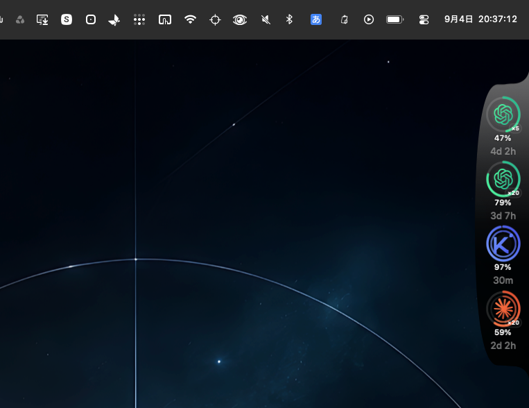
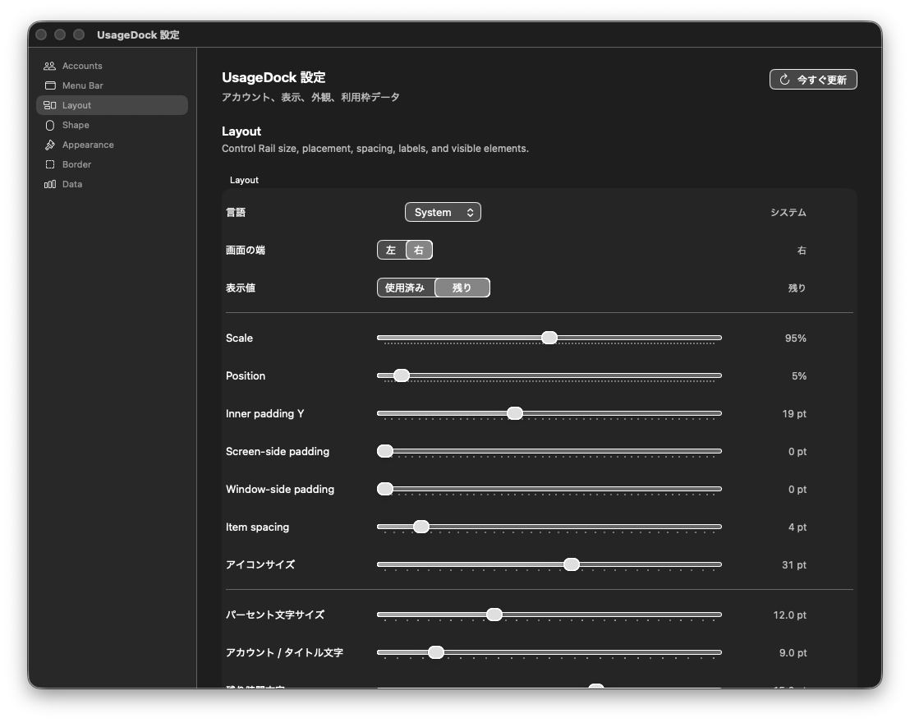

<p align="center">
  <a href="README.md"><strong>English</strong></a> ·
  <a href="README.ja.md">日本語</a> ·
  <a href="README.zh-CN.md">简体中文</a> ·
  <a href="README.zh-TW.md">繁體中文</a> ·
  <a href="README.ko.md">한국어</a> ·
  <a href="README.es.md">Español</a>
</p>

# UsageDock

UsageDock is a lightweight macOS edge rail for checking AI service usage and reset timing at a glance. It keeps quota state visible without forcing you into a full dashboard.

## Motion demo

<a href="https://drive.google.com/file/d/1I1TLPKhvvgevAjZ8R0ceHMxTLhVdE_f0/preview">
  
</a>

**▶ [Watch the UsageDock motion demo](https://drive.google.com/file/d/1I1TLPKhvvgevAjZ8R0ceHMxTLhVdE_f0/preview)**

## Preview

### Edge rail


### Settings



## What it does

- Shows provider/account usage in a compact edge rail.
- Supports up to three selected display accounts with independent menu bar selection.
- Displays rings, percentages, reset timing, provider/account colors, and configurable quota sources.
- Includes left/right edge placement, layout controls, border controls, materials, droplets, and elastic liquid-style drag interaction.
- Provides a compact macOS menu bar status item and popover for selected accounts.
- Persists appearance, placement, display-account, and menu-bar preferences across restarts.

## Provider click targets

In **Settings → Data → Provider Order, Colors & Click Targets**, choose **App** (default) or **Link** for each provider. **Choose App…** lists running apps or opens a Finder picker at `/Applications` for an `.app`; the chosen name/icon and preference persist across restarts. The same target is used by rail clicks, account menu actions, and menu-bar account rows.

Installed defaults are Claude → Claude.app, Codex → ChatGPT.app, Antigravity → Antigravity.app, Kimi → Kimi Code.app, Cursor → Cursor.app, and Grok → Grok Bot.app. If an app is missing or cannot launch, UsageDock opens the editable fallback URL and shows a status in settings and the click tooltip. Existing account URL overrides still take priority; empty/invalid URLs fall back to a valid provider URL. **Use Default App** and **Use Default URL** restore defaults. Choosing an app does not change account/login eligibility.

## Per-account rail quotas

In **Settings → Accounts → Rail display override**, choose the quota for **Percent**, **Outer**, **Inner**, and **Timer** independently. Antigravity offers each named bucket, including Gemini Models and Claude and GPT models for both 5h and 1w; other providers offer their own quota names. Kimi defaults to **Total** for Percent and Outer when the global source is Auto and the account has no override. Explicit quota choices persist per account across restarts and quota refreshes.

Quota-row names wrap and show their full name in a tooltip. A hidden or temporarily unavailable selected quota shows no value until it is enabled and available again; it never silently switches to another model's quota.

## Account policy

UsageDock is **login-only**.

- Claude, Codex, Antigravity, Kimi, and Grok can register through supported authenticated login/session flows.
- Cursor remains unavailable until UsageDock has a verified login and live-usage integration for that provider.
- Accounts that are not backed by a supported authenticated login are excluded from the active account set.

Grok has two logins. **Sign in on grok.com** opens an in-app window at `https://grok.com/?_s=usage`. That session stays in an isolated per-account web store and is the source for the weekly percentage and reset shown on grok.com Settings → Usage (`GetGrokCreditsConfig`). **Use Current Login** / **Login New Profile** still use `grok login`. If the web session is missing, expired, or the response cannot be decoded, UsageDock shows the CLI billing reading and says that the web login needs attention. It does not turn an undecodable web response into 0%. Cookies and tokens are not copied into UsageDock settings. Copy diagnostics copies decoded field paths only.

Kimi shows **Total**, **5h Code**, and **7d Code**. Total includes Kimi chat and code usage and its plan reset date. It reads the existing Kimi desktop login at `~/Library/Application Support/kimi-desktop/daimon-share/daimon/config.json` only when its user matches the registered Kimi Code login. Keep Kimi signed in to that same account; UsageDock does not copy or refresh the desktop credentials. If either API is unavailable, the available quotas remain visible with a status notice. See [the verified API findings](docs/KIMI_USAGE.md).

## Requirements

- macOS 14 or later
- Xcode 16+ recommended

## Build

Release:

```bash
xcodebuild \
  -project UsageDock.xcodeproj \
  -scheme UsageDock \
  -configuration Release \
  -derivedDataPath DerivedDataRelease \
  build
```

Debug:

```bash
xcodebuild \
  -project UsageDock.xcodeproj \
  -scheme UsageDock \
  -configuration Debug \
  -derivedDataPath DerivedData \
  build
```

## Account registration

Open **Settings → Accounts** and use the provider login controls. UsageDock only registers supported authenticated login/session sources.

## Project structure

- `UsageDock/Domain` — usage models, aggregation, and rail motion runtime
- `UsageDock/Providers` — provider adapters and live usage integrations
- `UsageDock/Storage` — persistent settings/account state
- `UsageDock/UI` — rail and settings UI
- `UsageDock/Window` — AppKit panel/window integration
- `UsageDockTests` — focused unit and behavior tests

See [`docs/ARCHITECTURE.md`](docs/ARCHITECTURE.md) for additional implementation notes.
